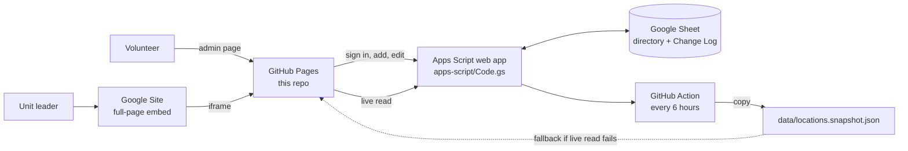

# Architecture

**Why it is built this way**

- **Static site, no build step.** Nothing to install or compile; anyone can edit a file on github.com and it goes live.
- **The Sheet is the source of truth.** Volunteers already know spreadsheets, and every edit is recoverable from the Sheet's version history and the Change Log tab.
- **Apps Script as the only door to the Sheet.** The Sheet ID and the passphrase never appear in this repo. All input is validated again on the server.
- **A saved copy in the repo.** If Google is slow or the script is paused, the public site still works.
- **Settings, categories, and styles are separate files** (`config.js`, `taxonomy.js`, `tokens.css`) so common changes don't touch logic.
- **Distance is calculated, not entered.** Each location's straight-line miles from the "home" point in `config.js` decides its distance band.

**Security notes**

- This repository is public (free GitHub Pages requires it). Do not commit passwords, secrets, or personal contact details.
- The Apps Script URL in `js/config.js` is not a secret; protection comes from the passphrase, the signed 8-hour session token, and the login lockout.
- Anyone with Editor access to the Google Sheet can read the script's stored passphrase. Keep that list short.
